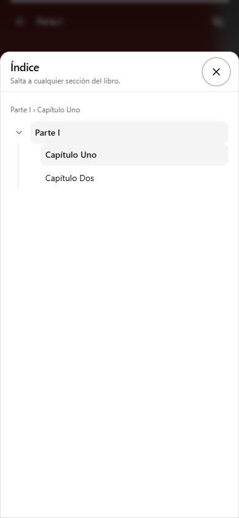
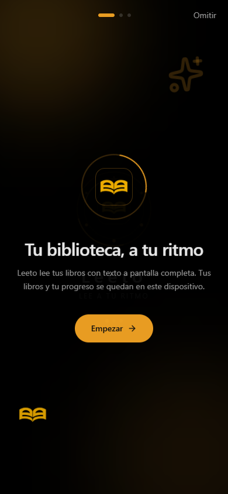

<div align="center">

<picture>
  <source srcset="docs/logo.webp" type="image/webp">
  
</picture>

# Leeto

### Lee tus libros a tu ritmo, sin cuenta ni nube de por medio.

**Leeto** abre EPUB, PDF, FB2, DOCX, ODT, CBZ y archivos de texto. El texto se ilumina mientras avanza, las imágenes aparecen en su momento y la biblioteca se queda en tu dispositivo.

<br>

`📚 EPUB + PDF + FB2 + DOCX/ODT + CBZ + TXT/MD/HTML`　`🔒 100 % local`　`📴 Funciona sin internet`　`🎧 Voz opcional`　`🌙 Tema automático`

</div>

---

## ✨ Así se siente

| 📚 Tu biblioteca | 🎬 El lector | 🧭 Tu índice |
| :---: | :---: | :---: |
|  |  |  |
| Portadas, progreso y tiempo restante de un vistazo. | Desliza y el texto sigue el ritmo contigo. | Capítulos y secciones reales, sin perderte nunca. |

<br>

<div align="center">

<br><sub>Una misma app: móvil, tablet y escritorio. 🖥️📱</sub>
</div>

---

## La primera apertura

La primera vez, Leeto te recibe con un recorrido de dos pasos: bienvenida y gestos.
No pide nombre ni permisos especiales: solo abres los archivos que tú eliges, y tu progreso se queda en este dispositivo. Después, pulsa **Añadir** para cargar tus libros.

Bajo el logo verás siempre la versión y el canal, por ejemplo **v0.1.0 · Beta**.

| La bienvenida | Tus gestos |
| :---: | :---: |
|  |  |

---

## Qué incluye

- **🎬 Lectura en clips.** El texto se muestra completo y una suave luz guía la palabra activa. No hay saltos raros ni animaciones que distraigan.
- **👆 Desliza y sigue.** Sube o baja para cambiar de fragmento. La lectura continúa, no se reinicia.
- **🖼️ Imágenes con calma.** Aparecen arriba, con su pie debajo y un movimiento muy sutil, como una película tranquila. En los CBZ el progreso avanza página a página.
- **💬 Citas al instante.** Guarda el fragmento exacto que estás leyendo con un toque y una animación de «captura».
- **🧭 Índice de verdad.** La tabla de contenidos de tu EPUB o PDF se respeta tal cual; en FB2, TXT, Markdown y HTML se genera a partir de sus encabezados.
- **🎧 Escucha si quieres.** Activa la voz local y sigue el mismo ritmo visual. Si no quieres oír nada, también funciona perfecto.
- **🌙 Se adapta a ti.** Sigue automáticamente el tema claro u oscuro de tu dispositivo, o elige uno de los cinco estilos disponibles.

<div align="center">

</div>

---

## 🔐 Tu biblioteca es tuya

No hay cuentas, no hay anuncios y no hay servidores de Leeto guardando tus cosas.
Tus libros, tu progreso y tus citas viven en tu dispositivo. Si decides sincronizar,
usas **tu propio** WebDAV o una carpeta que tú elijas. Tú mandas. 🗝️

> 📴 **Offline de verdad.** Una vez abierta, la app sigue funcionando aunque te quedes sin conexión.
> En Android el APK se compila con `allowBackup="false"`, así que ni la biblioteca ni el progreso se envían a la nube.

---

## 🤖 App de Android

En la web de Android aparece un aviso cerrable para descargar el APK; también está en **Ajustes → App de Android**. El archivo se sirve como estático desde `public/downloads/` y también se publica en [GitHub Releases](https://github.com/lazzzarito/Leeto/releases/tag/v0.1.0-beta). El nombre siempre incluye versión y canal: `Leeto-0.1.0-beta.apk` en beta, `Leeto-0.1.0.apk` en la versión normal.

Dentro de la APK, la voz usa el `TextToSpeech` nativo y un servicio en primer plano: la reproducción continúa al salir de la app y la notificación del sistema ofrece anterior, play/pausa, siguiente y cierre. El header muestra un pequeño indicador centrado mientras se escucha.

### Generar la APK sin Android Studio

Necesitas un JDK 21 portable, el SDK de Android ya instalado y Gradle (el wrapper lo descarga desde un espejo local si hace falta). La versión y el canal salen de `package.json` y `VITE_BUILD_CHANNEL` (`beta` por defecto), así que no hay que tocar `build.gradle`.

```bash
npm install
npm run build
npx cap sync android
cd android
gradlew.bat assembleRelease --no-daemon -I mirrors.init.gradle
```

La firma se lee de `~/.leeto-keys/leeto-release.properties` (fuera del repositorio). La APK firmada queda en `android/app/build/outputs/apk/release/app-release.apk`; se copia a `public/downloads/Leeto-0.1.0-beta.apk` y a `Leeto-release.apk` en la raíz. Después vuelve a ejecutar `npm run build` para que `dist/downloads/` incluya el archivo sin meterlo dentro de la propia APK.

Para verificarla:

```bash
apksigner verify --print-certs Leeto-release.apk
aapt dump badging Leeto-release.apk
```

---

## 🚀 Empieza en tres pasos

1. **Abre Leeto** y desliza por la bienvenida y los gestos. 👋
2. **Añade libros** con «Añadir» (archivos sueltos o raíces guardadas) o arrástralos a la pantalla. 📥
3. **Pulsa portada y lee.** El resto lo haces deslizando. 🎬

<br>

---

## Despliegue

`npm run build` genera un sitio estático en `dist/`. La configuración de Vercel está en `vercel.json`: redirige las rutas SPA a `index.html` y separa la caché del service worker de la de los assets con hash.

El canonical, `og:url`, `og:image`, `sitemap.xml` y `robots.txt` apuntan a `https://leeto.vercel.app/` (ver `.env.production`). Para otro dominio, cambia `VITE_SITE_URL` antes de compilar. En desarrollo, sin el plugin de build, la app calcula el canonical desde el navegador.

Para instalar Leeto como aplicación necesitas servirla por HTTPS (Vercel ya lo hace) y un navegador compatible. El aviso de instalación lo muestra el navegador; la app no puede forzarlo.

## Límites

- Los PDF escaneados necesitan OCR: sin texto seleccionable no se puede seguir la lectura palabra por palabra.
- MOBI, AZW3 y DJVU no son compatibles. Convierte esos archivos a EPUB o PDF antes de importarlos.

<div align="center">

Hecho con ❤️‍🔥 por [1azarito](https://1azarito.vercel.app)

</div>
