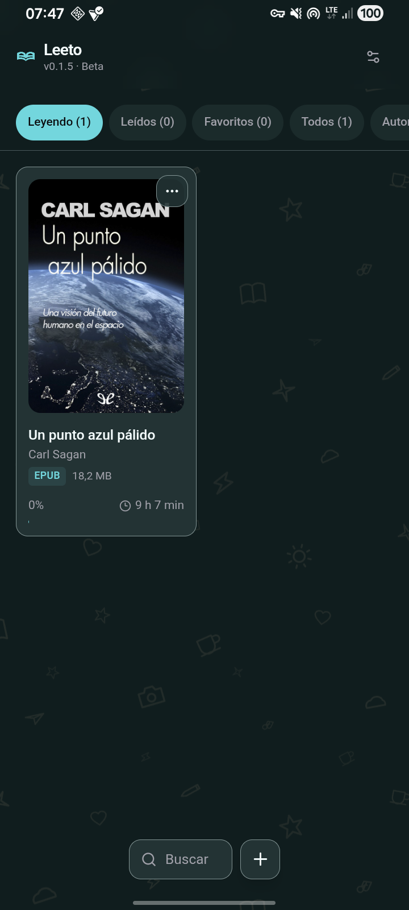
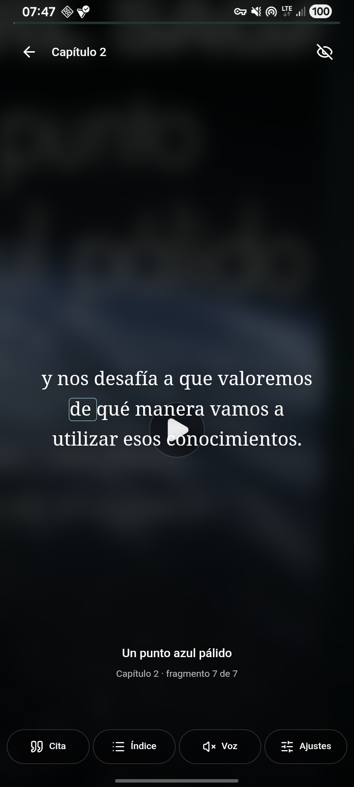
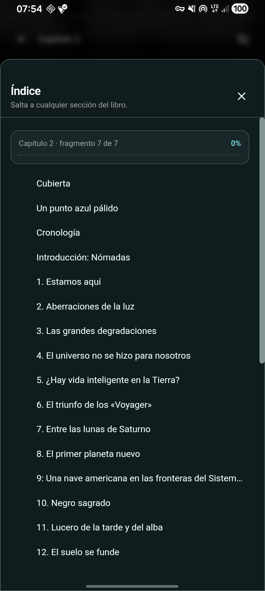
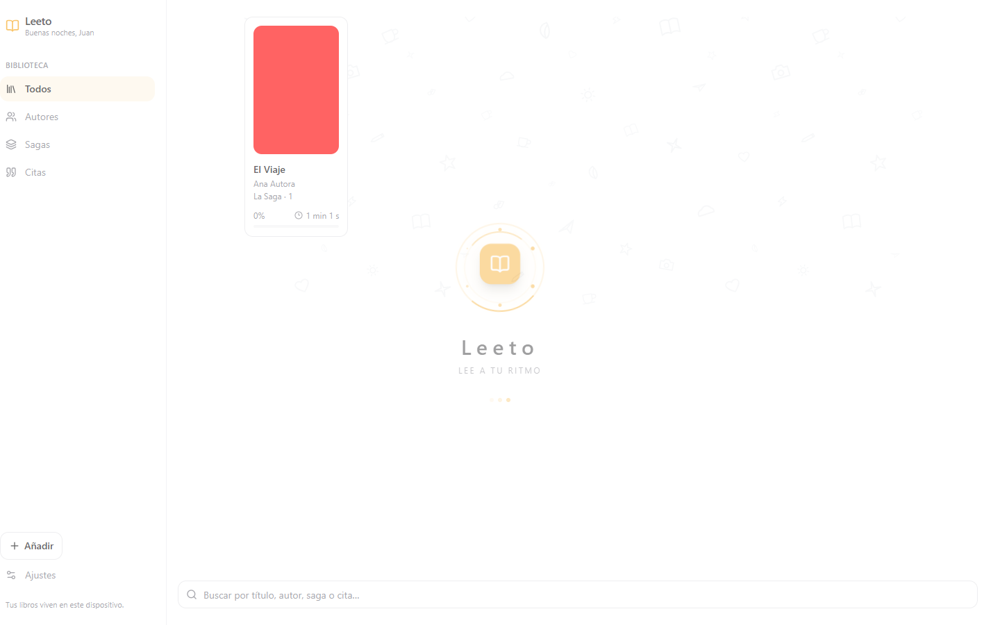
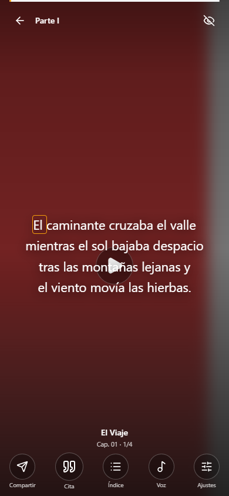
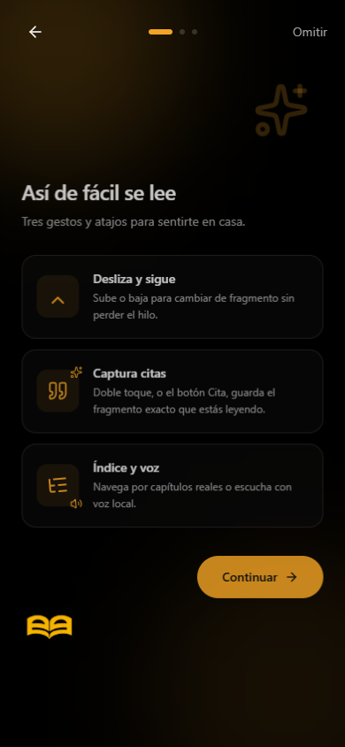
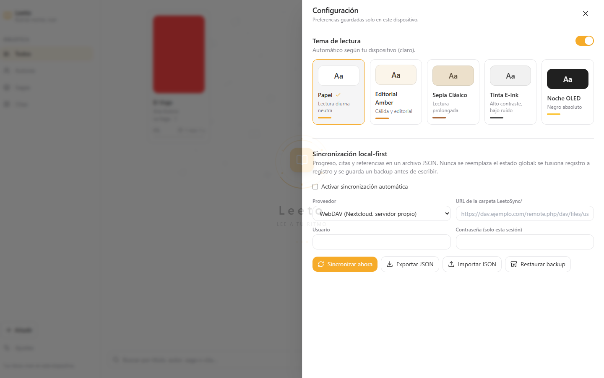

<picture>
  <source srcset="docs/logo.webp" type="image/webp">
  
</picture>

# Leeto

### Tu próxima lectura, sin distracciones.

**Leeto** es un lector bonito, ligero y tuyo. Abre tus libros, sigue el texto con una guía suave y retoma justo donde lo dejaste, incluso cuando cierras la app.

 

`📚 EPUB · PDF · cómics · texto`　`🔒 Solo en tu dispositivo`　`📴 Sin internet`　`🎧 Con voz si quieres`　`🌙 Se adapta a ti`

 

[**Descargar para Android**](https://github.com/lazzzarito/Leeto/releases/tag/v0.1.7-beta)

---

## Una forma más tranquila de leer

Leeto no intenta parecer una biblioteca complicada. Abres un libro, deslizas y lees. El texto te acompaña, las imágenes respiran y tu progreso se guarda solo.

| Tu biblioteca, siempre lista | Lectura a pantalla completa | Un índice que sí te ubica |
| :---: | :---: | :---: |
|  |  |  |
| Portadas claras, progreso visible y todo a mano. | El texto avanza contigo, sin romper tu ritmo. | Salta a la sección exacta y mira por dónde vas. |

 

 Se ve igual de bien en móvil, tablet y escritorio.

---

## Lo que hace especial a Leeto

### 🎬 Leer se siente fluido
El texto se ilumina suavemente mientras avanzas. No tienes que pelear con la página: solo seguir la historia.

### 👆 Gestos naturales
Desliza para pasar al siguiente fragmento. Cuando quieres volver, vuelves. Cuando quieres seguir, Leeto ya está ahí.

### 🧭 Nunca pierdes el hilo
El índice te muestra capítulos, secciones y tu avance actual, para que siempre sepas dónde estás.

 Cada fragmento aparece limpio, cómodo y listo para seguir.

### 💬 Guarda lo que te marcó
¿Una frase que no quieres olvidar? Guárdala como cita en un toque y vuelve a ella cuando quieras.

### 🎧 Escucha cuando te venga mejor
Activa la voz y deja que Leeto te acompañe mientras caminas, descansas o tienes las manos ocupadas.

### 🌙 Se adapta a tu momento
Claro de día, oscuro de noche, o con el estilo que mejor te siente. Leeto se acomoda a ti.

---

## Empieza en segundos

No hay cuentas que crear ni formularios eternos. Abres Leeto, eliges tus libros y empiezas a leer.

| Bienvenida simple | Gestos claros desde el inicio |
| :---: | :---: |
|  |  |

1. **Abre Leeto.** Te recibe con una bienvenida rápida y clara.
2. **Añade tus libros.** Elige archivos desde tu dispositivo o arrástralos.
3. **Empieza a leer.** Tu progreso se queda guardado automáticamente.

---

## Tus libros, tus citas, tu espacio

Leeto está pensado para que leer vuelva a sentirse personal.

- **Sin cuenta.** Entras y lees.
- **Sin anuncios.** Nada compite con tu libro.
- **Sin nube obligatoria.** Tu biblioteca vive en tu dispositivo.
- **Sin conexión, sin problema.** Cuando ya abriste Leeto, puedes seguir leyendo.

> Tu biblioteca es tuya. Leeto solo está ahí para ayudarte a disfrutarla.

---

## En Android, te acompaña a todas partes

Lleva tus libros en el bolsillo y sigue leyendo como prefieras: en pantalla, con voz o retomando justo donde lo dejaste.

- Descarga la APK desde [GitHub Releases](https://github.com/lazzzarito/Leeto/releases/tag/v0.1.7-beta).
- Instálala en tu Android y abre tus libros al instante.
- Si escuchas con voz, puedes salir de la app y seguir con el audio desde la notificación.

 Ajusta la lectura a tu gusto: ritmo, tema, voz y más.

---

## Formatos que puedes abrir

Leeto abre los formatos más comunes para que no tengas que andar convirtiendo todo:

**EPUB · PDF · FB2 · DOCX · ODT · CBZ · TXT · MD · HTML**

Algunos PDF escaneados necesitan texto reconocible para poder seguir la lectura palabra por palabra. Los formatos MOBI, AZW3 y DJVU no son compatibles por ahora.

---

### ¿Listo para volver a leer con gusto?

[**Descargar Leeto para Android**](https://github.com/lazzzarito/Leeto/releases/tag/v0.1.7-beta)

 

Hecho con cariño por [1azarito](https://1azarito.vercel.app)

