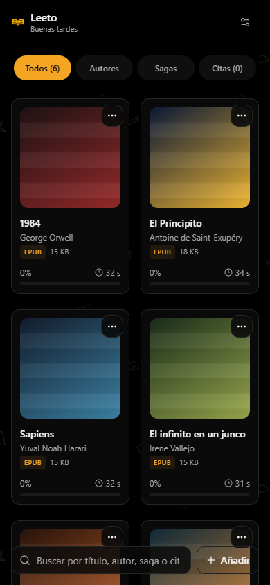
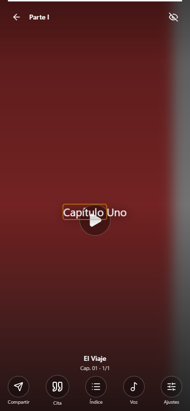
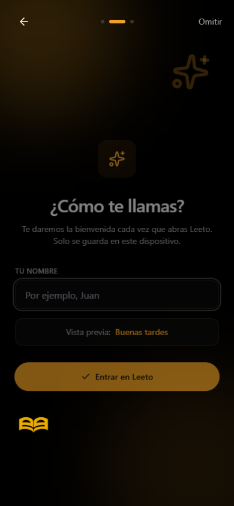

<picture>
  <source srcset="docs/logo.webp" type="image/webp">
  
</picture>

# Leeto

### Lee tus libros a tu ritmo, sin cuenta ni nube de por medio.

**Leeto** abre EPUB, PDF, FB2, DOCX, ODT, CBZ y archivos de texto. El texto se ilumina mientras avanza, las imágenes aparecen en su momento y la biblioteca se queda en tu dispositivo.

 

`📚 EPUB + PDF + FB2 + DOCX/ODT + CBZ + TXT/MD/HTML`　`🔒 100 % local`　`📴 Funciona sin internet`　`🎧 Voz opcional`　`🌙 Tema automático`

---

## ✨ Así se siente

| 📚 Tu biblioteca | 🎬 El lector | 🧭 Tu índice |
| :---: | :---: | :---: |
|  |  |  |
| Portadas, progreso y tiempo restante de un vistazo. | Desliza y el texto sigue el ritmo contigo. | Capítulos y secciones reales, sin perderte nunca. |

 

 Una misma app: móvil, tablet y escritorio. 🖥️📱

---

## La primera apertura

La primera vez, Leeto te recibe con un pequeño recorrido y te pregunta tu nombre.
Desde entonces, arriba de todo verás un saludo que cambia con el día:
**«Buenos días, Juan»**, **«Buenas tardes, Laura»** o **«Buenas noches, Pepe»**. ☀️🌆🌙

| La bienvenida | Tus gestos | Tu nombre |
| :---: | :---: | :---: |
|  |  |  |

---

## Qué incluye

- **🎬 Lectura en clips.** El texto se muestra completo y una suave luz guía la palabra activa. No hay saltos raros ni animaciones que distraigan.
- **👆 Desliza y sigue.** Sube o baja para cambiar de fragmento. La lectura continúa, no se reinicia.
- **🖼️ Imágenes con calma.** Aparecen arriba, con su pie debajo y un movimiento muy sutil, como una película tranquila. En los CBZ el progreso avanza página a página.
- **💬 Citas al instante.** Guarda el fragmento exacto que estás leyendo con un toque y una animación de «captura».
- **🧭 Índice de verdad.** La tabla de contenidos de tu EPUB o PDF se respeta tal cual; en FB2, TXT, Markdown y HTML se genera a partir de sus encabezados.
- **🎧 Escucha si quieres.** Activa la voz local y sigue el mismo ritmo visual. Si no quieres oír nada, también funciona perfecto.
- **🌙 Se adapta a ti.** Sigue automáticamente el tema claro u oscuro de tu dispositivo, o elige uno de los cinco estilos disponibles.

---

## 🔐 Tu biblioteca es tuya

No hay cuentas, no hay anuncios y no hay servidores de Leeto guardando tus cosas.
Tus libros, tu progreso y tus citas viven en tu dispositivo. Si decides sincronizar,
usas **tu propio** WebDAV o una carpeta que tú elijas. Tú mandas. 🗝️

> 📴 **Offline de verdad.** Una vez abierta, la app sigue funcionando aunque te quedes sin conexión.

---

## 🚀 Empieza en tres pasos

1. **Abre Leeto** y dinos cómo te llamas. 👋
2. **Añade libros** con «Añadir» (archivos sueltos, una carpeta completa o raíces guardadas) o arrástralos a la pantalla. 📥
3. **Pulsa portada y lee.** El resto lo haces deslizando. 🎬

 

---

## Despliegue

`npm run build` genera un sitio estático en `dist/`. Si lo publicas en un dominio propio, define `VITE_SITE_URL=https://tu-dominio/ruta/` antes de compilar: así el canonical, `og:url`, `sitemap.xml` y `robots.txt` apuntan a esa URL. Sin esa variable, la app calcula el canonical en el navegador y no genera sitemap.

Hecho con ❤️‍🔥 por [1azarito](https://1azarito.vercel.app)

